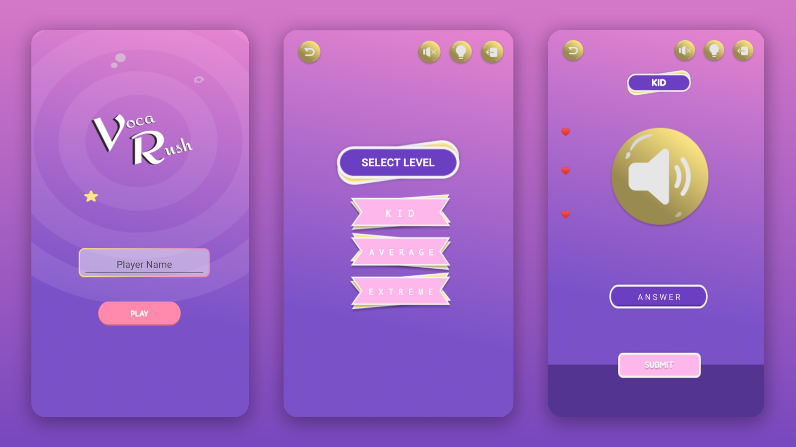
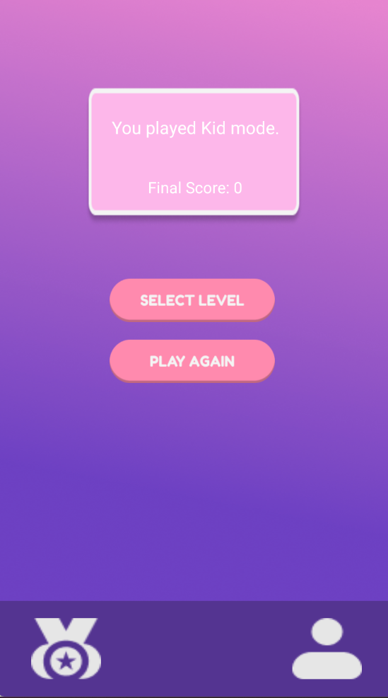
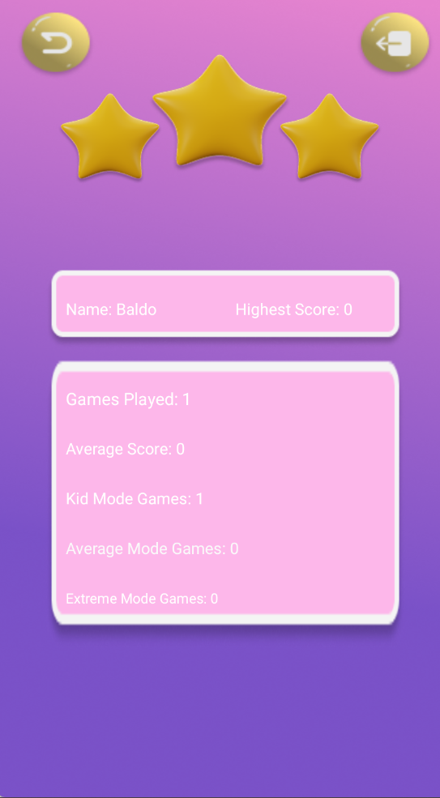
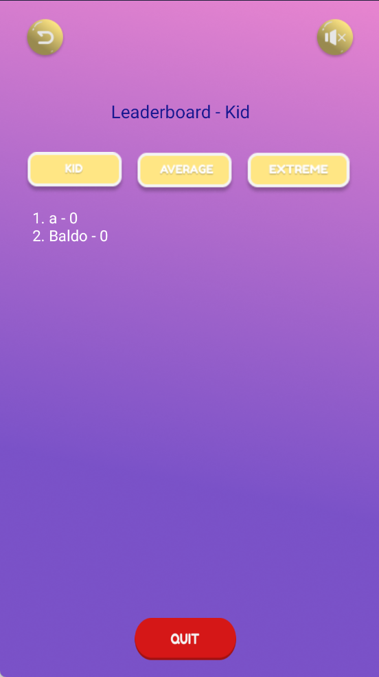

# VocaRush

**An Android spelling game that helps players build their vocabulary through listening.**

VocaRush reads a word aloud with text-to-speech, and the player has to type the correct spelling before time runs out. It has three difficulty levels, hints for every word, and a leaderboard that is saved on the device.


---

## Screenshots



<table>
  <tr>
    <td width="50%"><br><sub>Results screen with the final score</sub></td>
    <td width="50%"><br><sub>Player profile with games played and average score</sub></td>
  </tr>
  <tr>
    <td width="50%"><br><sub>Kid-mode leaderboard</sub></td>
  </tr>
</table>

## Features

- **Three difficulty levels:** Kid, Average and Extreme, with 10 words each, shuffled every game
- **Text-to-speech:** each word is spoken aloud, and the player can replay it
- **Timed rounds:** 15 seconds per word and 3 lives per game
- **Hints:** a short definition is available for every word
- **Persistent leaderboard:** the top 10 scores for each level are stored in SQLite and kept after the app is closed
- **Player profile:** shows the player's overall score (best Kid + Average + Extreme score) and overall ranking
- **Results screen:** shows the final score and level at the end of each game

## How to Play

1. Enter your name and choose a level.
2. Tap the speaker button to hear the word. The 15-second timer starts.
3. Type the spelling and press Enter. Correct answers earn 10 points.
4. A wrong answer or running out of time costs one life. The game ends when all lives are lost or all words are answered.

## My Role

I worked on this team project as the **Mobile Developer** and led the team as **Project Manager**.

- Implemented text-to-speech that reads each word aloud for players to spell.
- Built quiz gameplay that checks typed answers against the correct spelling.
- Stored questions, scores, and a leaderboard locally with SQLite to track player progress.

## Tech Stack

| Area | Technology |
|---|---|
| Language | B4X (BASIC) |
| Framework | B4A (Basic4Android) |
| Database | SQLite (B4A SQL library) |
| Speech | Android Text-to-Speech (B4A TTS library) |

## Project Structure

```
VocaRush/
├── spellingGame.b4a      # Main project file (name entry screen)
├── Starter.bas           # App service: opens the database on launch
├── Database.bas          # SQLite: save scores, leaderboard, profile stats
├── Level.bas             # Level selection screen
├── Kid.bas               # Game screens for each level
├── Average.bas
├── Extreme.bas
├── Result.bas            # Results screen
├── Leaderboard.bas       # Leaderboard screen
├── Profile.bas           # Player profile screen
├── Instructions.bas      # How-to-play screen
└── Files/                # Screen layouts (.bal)
```

## Getting Started

### Prerequisites

- [B4A](https://www.b4x.com/b4a.html) (free), set up with the Android SDK and Java JDK
- An Android device or emulator running Android 5.0 (API 21) or newer

### Build and Run

```bash
git clone https://github.com/yeldsg/vocarush.git
```

1. Open `spellingGame.b4a` in B4A.
2. Connect an Android device with USB debugging turned on, or start an emulator.
3. Press **Run** (F5) to build and install the app.

## About This Project

VocaRush was built as a team project for a mobile development course (April – May 2025).

## Author

**Kathrina Marhiel Zamora** · BS Information Technology, Pampanga State University
GitHub: [@yeldsg](https://github.com/yeldsg) · Portfolio: [yeldsg-portfolio.vercel.app](https://yeldsg-portfolio.vercel.app) · LinkedIn: [linkedin.com/in/yeldsg](https://www.linkedin.com/in/yeldsg)
